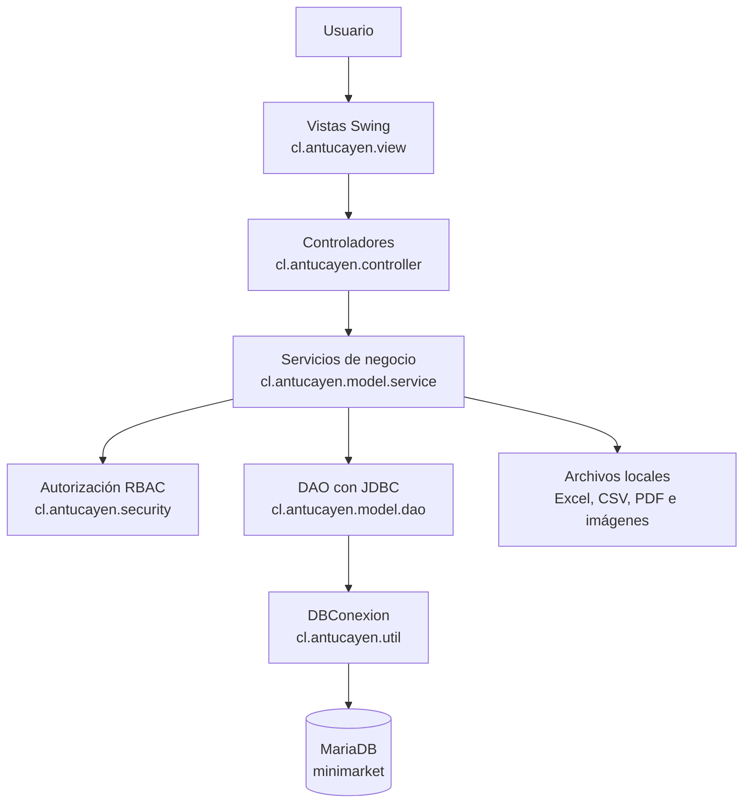
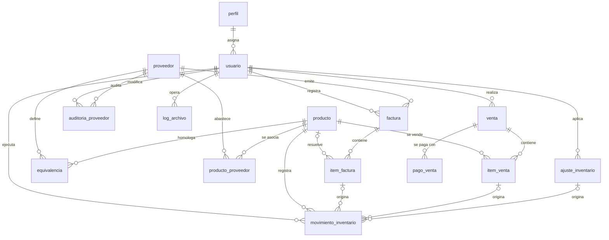

# Minimarket Antucayen — Sistema de Gestión


Aplicación de escritorio **Java/Swing** para la gestión del Minimarket Antucayen de San Bernardo: productos y stock, proveedores, facturas de compra, punto de venta, historial de movimientos, reportes y usuarios con control de acceso por roles, sobre una base de datos **MariaDB**.

Proyecto del **Grupo 20** de Ingeniería de Software, desarrollado en cuatro incrementos con Scrum++ para el cliente don Guido de Lapeyra Úbeda.

## Tabla de contenidos

1. [Descripción](#descripción)
2. [Funcionalidades](#funcionalidades)
3. [Tecnologías](#tecnologías)
4. [Arquitectura](#arquitectura)
5. [Estructura del repositorio](#estructura-del-repositorio)
6. [Requisitos](#requisitos)
7. [Instalación rápida](#instalación-rápida)
8. [Configuración](#configuración)
9. [Base de datos](#base-de-datos)
10. [Ejecución](#ejecución)
11. [Uso](#uso)
12. [API y endpoints](#api-y-endpoints)
13. [Roles y permisos](#roles-y-permisos)
14. [Pruebas](#pruebas)
15. [Despliegue en Windows](#despliegue-en-windows)
16. [Documentación del proyecto](#documentación-del-proyecto)
17. [Estado actual](#estado-actual)
18. [Solución de problemas](#solución-de-problemas)
19. [Equipo](#equipo)
20. [Licencia](#licencia)

## Descripción

**Minimarket Antucayen** reemplaza la gestión manual del inventario y de las facturas de proveedores por un sistema de escritorio que cubre la operación diaria del local:

- Catálogo de productos y control de stock.
- Proveedores y equivalencias entre los códigos de cada proveedor y los SKU internos.
- Registro y procesamiento de facturas de compra, con ingreso manual o extracción de ítems desde PDF, imágenes, Excel o CSV.
- Ajustes masivos de inventario desde archivos Excel o CSV, con validación y previsualización.
- Punto de venta con pago en efectivo, débito, crédito o combinado, cálculo de vuelto y comprobante imprimible.
- Historial de movimientos de inventario, reportes, exportaciones y auditoría de archivos.
- Administración de usuarios con tres roles: Administrador, Bodeguero y Cajero.

Cada compra, venta, ajuste o reversión modifica el stock mediante operaciones transaccionales que registran un movimiento de inventario asociado al usuario que las ejecuta.

| Dato | Valor |
|---|---|
| Tipo de aplicación | Escritorio, Java Swing |
| Artefacto Maven | `cl.antucayen:Antucayen:1.0-SNAPSHOT` |
| Clase principal | `cl.antucayen.Main` |
| Base de datos | MariaDB, base `minimarket` |
| Scripts SQL | `database/Antucayen_DDL.sql` y `database/Antucayen_DML.sql` |

## Funcionalidades

### Autenticación y sesión

- Inicio de sesión con usuario y contraseña. Solo ingresan usuarios activos cuyo perfil sea uno de los tres roles soportados.
- Contraseñas almacenadas con PBKDF2-HMAC-SHA256 (210.000 iteraciones y sal aleatoria de 16 bytes). Los hashes SHA-256 heredados se aceptan y se migran automáticamente a PBKDF2 tras un inicio de sesión correcto.
- Verificación del esquema de la base de datos antes de autenticar: tablas, columnas y catálogo de perfiles.
- Pantalla inicial según el rol: Dashboard (Administrador), Productos (Bodeguero) o Punto de Venta (Cajero).
- Cierre de sesión con confirmación y expiración automática tras 30 minutos de inactividad por defecto (configurable con `-Dantucayen.sesion.inactividad.minutos=10`, por ejemplo).

### Dashboard

Disponible para el Administrador. Muestra las ventas de hoy (total y desglose por Efectivo, Débito y Crédito), las ventas del mes, los productos activos, las facturas pendientes, los movimientos del día, la cantidad de productos activos con stock bajo (10 unidades o menos) y el top 5 de productos más vendidos del mes.

### Punto de Venta

Disponible para Administrador y Cajero.

- Búsqueda o escaneo por SKU, código de barras o nombre. La barra de búsqueda recibe el foco automáticamente al abrir o volver al POS y tras completar una venta; solo se pueden vender productos activos y con stock.
- Carrito con cantidades editables y validación de stock disponible. La edición activa se confirma antes de cobrar. «Quitar seleccionado» elimina únicamente el producto (fila completa) escogido, sin vaciar el resto del carrito.
- Pago único (Efectivo, Débito o Crédito) o dividido entre varios medios, con cálculo en vivo de lo que falta o del vuelto. El vuelto solo puede provenir del efectivo recibido.
- Atajos dentro del POS: **F5** vacía el carrito y los montos de pago; **F8** prepara un pago mixto (limpia los montos y enfoca el campo Efectivo para distribuir los importes); **F9** prepara el monto exacto por Transbank (se elige Débito o Crédito); **F12** prepara el pago exacto en Efectivo. F9 y F12 llevan a la confirmación habitual del cobro; no registran la venta sin confirmarla. F9 solo registra el medio de pago elegido: no se comunica con el dispositivo Transbank.
- Confirmación atómica de la venta: bloquea los productos, revalida stock, estado y precio, aplica el precio vigente del producto, descuenta el stock y registra movimientos de tipo `Venta`. La fecha de inicio real de la operación se conserva separada de la confirmación del cobro.
- Comprobante de venta automático, visualizable e imprimible. Si la visualización falla después de registrar el cobro, el sistema informa que la venta sí fue confirmada y permite recuperar el comprobante.
- Listado de ventas del día (el Cajero ve solo las suyas) y anulación de ventas pagadas con devolución de stock, reservada al Administrador.

### Productos y stock

Consulta para los tres roles; gestión para Administrador y Bodeguero.

- Búsqueda por nombre, SKU o código de barras.
- Alta, edición e inactivación lógica de productos. El SKU y el código de barras son únicos y cada producto puede asociarse a uno o más proveedores.
- El stock no se edita desde la ficha del producto: solo cambia mediante compras, ventas, ajustes y reversiones.
- Consulta del stock actual y de los últimos 10 movimientos de un producto con «Stock + últimos 10».
- Al confirmar una venta se valida el stock por SKU, sumando las líneas repetidas del carrito antes de compararlas con el disponible.

### Proveedores y equivalencias

Disponible para Administrador y Bodeguero.

- Alta y edición de proveedores (RUT opcional; nombre, teléfono y correo electrónico obligatorios). Cada campo modificado queda registrado en `auditoria_proveedor`.
- Equivalencias entre el código interno del proveedor y el SKU del sistema: las registran Administrador y Bodeguero; solo el Administrador puede modificarlas o eliminarlas.
- Consulta de equivalencias con filtros combinables por proveedor, código interno y SKU.

### Facturas de compra

Disponible para Administrador y Bodeguero.

- Registro con ingreso manual de ítems o desde un archivo digital (PDF máximo 10 MB), con vista previa y extracción de ítems. En los PDF se intenta primero el texto embebido y, si no se obtienen ítems, se aplica OCR página por página.
- Control de duplicados por proveedor y número de factura.
- Resolución automática del SKU de cada ítem mediante las equivalencias del proveedor. Cada ítem queda `Válido`, `Observado` o `No Procesado`, y la factura `Pendiente`, `Observada` o `Procesada`.
- Procesamiento: ingresa al stock los ítems válidos, una sola vez por ítem, y permite reprocesar la factura después de corregir sus equivalencias. La corrección manual de la equivalencia de un ítem observado está reservada al Administrador.
- El reproceso de una factura ya `Procesada` requiere autorización explícita del Administrador y revierte los ingresos anteriores antes de reaplicarlos.
- Consulta con filtros por número, proveedor, rango de fechas y estado, y apertura del archivo adjunto.

### Importación y ajuste masivo de inventario

Disponible para Administrador y Bodeguero.

- Carga de archivos `.xlsx`, `.xls` o `.csv` (máximo 10 MB) cuya primera fila contenga las columnas `SKU` y `cantidad`. En CSV se acepta `,` o `;` como separador.
- Dos modalidades, sin valor por defecto: `Sumar al stock actual` o `Reemplazar stock actual`.
- Previsualización con el stock proyectado, reporte de errores por fila y resolución de SKU duplicados (consolidar o rechazar cada grupo).
- Las cantidades negativas solo se admiten con la opción «Corrección autorizada», exclusiva del Administrador.
- Aplicación atómica del ajuste y posterior reversión completa del ajuste, reservada al Administrador.

### Historial y reportes

Disponibles para los tres roles.

- Historial de movimientos con filtros por SKU, tipo de movimiento y rango de fechas.
- Reportes de stock actual, equivalencias faltantes, facturas (por estado y fechas) y movimientos (por rango de fechas).

### Exportaciones

| Exportación | Pantalla y acción | Formatos |
|---|---|---|
| Inventario (productos activos) | Productos → «Exportar CSV/Excel» | CSV, XLSX |
| Historial de movimientos | Historial → «Exportar CSV/Excel» | CSV, XLSX |
| Ítems válidos de una factura | Procesamiento de Factura → «Exportar válidos» | CSV, XLSX |
| Reporte generado en pantalla | Reportes → «Exportar Excel» | XLSX |
| Plantilla de importación | Importar inventario → «Descargar plantilla» | CSV, XLSX |

Los CSV se generan en UTF-8 con BOM y separados por comas. Cada importación, exportación y plantilla queda registrada en la tabla `log_archivo`, que el Administrador consulta en el módulo «Auditoría» del menú.

### Usuarios y personalización

- Creación, edición (nombre completo, nombre de usuario y perfil) y desactivación de usuarios, reservadas al Administrador.
- Cinco temas visuales: Azul Corporativo, Verde Esmeralda, Púrpura Elegante, Naranja Cálido y Oscuro Nocturno. Se eligen en la pantalla de inicio de sesión o con «Cambiar tema» en el menú lateral.

## Tecnologías

| Componente | Tecnología | Versión | Uso en el proyecto |
|---|---|---|---|
| Lenguaje | Java | 21 (`maven.compiler.release`) | Código de la aplicación |
| Interfaz | Swing + FlatLaf | FlatLaf 3.5.4 | Ventanas, formularios y tema `FlatLightLaf` |
| Base de datos | MariaDB | — | Persistencia |
| Conector JDBC | `mariadb-java-client` | 3.3.3 | Conexión a MariaDB |
| Excel | Apache POI (`poi-ooxml`) | 5.2.5 | Lectura de `.xlsx`/`.xls` y generación de `.xlsx` |
| CSV | OpenCSV | 5.9 | Lectura de archivos CSV |
| PDF | Apache PDFBox | 3.0.3 | Texto embebido y renderizado de páginas |
| OCR | Tess4J | 5.13.0 | Reconocimiento de texto en facturas escaneadas |
| Pruebas | JUnit Jupiter | 5.10.2 | Pruebas unitarias |
| Build | Apache Maven | — | `maven-compiler-plugin` 3.13.0, `maven-surefire-plugin` 3.2.5, `maven-shade-plugin` 3.5.3 |

## Arquitectura

La aplicación sigue una arquitectura en capas (MVC con capa de servicios y DAO):



| Capa | Paquete | Responsabilidad |
|---|---|---|
| Vista | `cl.antucayen.view` | Pantallas y diálogos Swing. No acceden a los DAO. |
| Controlador | `cl.antucayen.controller` | Conectan los eventos de las vistas con los servicios y muestran los resultados. |
| Servicio | `cl.antucayen.model.service` | Reglas de negocio, validaciones, autorización y transacciones. |
| Acceso a datos | `cl.antucayen.model.dao` | SQL sobre MariaDB mediante `PreparedStatement`. |
| Modelo | `cl.antucayen.model.entity`, `cl.antucayen.model.dto`, `cl.antucayen.model.domain` | Entidades, proyecciones de lectura y enumeraciones de estado. |
| Seguridad | `cl.antucayen.security` | Roles (`RolSistema`), autorización (`Autorizacion`), hash de contraseñas (`PasswordHasher`), sesión (`SesionActual`) y expiración por inactividad (`ControlInactividadSesion`). |
| Utilidades | `cl.antucayen.util` | Conexión (`DBConexion`), sesión (`SesionActual`), verificación de esquema (`VerificadorEsquema`) y temas (`GestorTemas`, `Tema`). |

Decisiones de diseño relevantes:

- **Autorización en los servicios.** `Autorizacion` centraliza los permisos y se invoca desde los servicios de negocio, de modo que la seguridad no depende de ocultar botones u opciones del menú.
- **Sesión en memoria.** `SesionActual` mantiene el usuario autenticado durante la ejecución de la aplicación.
- **Conexión única y transacciones.** `DBConexion` es un singleton con una conexión JDBC compartida. Las operaciones que afectan a varias tablas se ejecutan con `ejecutarEnTransaccion(...)`, que confirma o revierte el conjunto y se integra en una transacción ya abierta.
- **Bloqueo de filas.** Las operaciones sobre stock, ventas, facturas y ajustes leen con `SELECT ... FOR UPDATE` antes de modificar.
- **Contrato de esquema.** `VerificadorEsquema` comprueba al iniciar sesión que existan las tablas, columnas y perfiles que usa la aplicación.
- **Montos enteros.** Precios y montos se almacenan como `INT` en pesos; el stock y las cantidades de los movimientos usan `DECIMAL(12,3)`.

## Estructura del repositorio

```text
.
├── .github/workflows/
│   ├── generar-instalador-windows.yml   # Genera el instalador y el portable en GitHub Actions
│   └── build-windows-exe.yml            # Genera la imagen de aplicación Windows
├── Documentacion Grupo 20/
│   ├── Documento 0/                     # Requerimientos iniciales
│   ├── Incremento 1/ … Incremento 4/    # Informes, diagramas y evidencias de cada incremento
│   └── Proveedores.pdf
├── database/
│   ├── Antucayen_DDL.sql                # Crea la base minimarket, sus 15 tablas y el usuario de la aplicación
│   └── Antucayen_DML.sql                # Carga perfiles, usuarios, productos, proveedores y equivalencias
├── despliegue-windows/
│   ├── Generar-Windows.ps1              # jpackage + Inno Setup: portable .zip e instalador .exe
│   ├── Antucayen-Setup.iss              # Script del instalador Inno Setup
│   ├── antucayen.ico
│   └── tessdata/                        # Aquí se copian los .traineddata opcionales del OCR
├── src/
│   ├── main/
│   │   ├── java/cl/antucayen/
│   │   │   ├── Main.java                # Punto de entrada
│   │   │   ├── controller/              # 13 controladores
│   │   │   ├── model/
│   │   │   │   ├── dao/                 # 15 DAO con JDBC
│   │   │   │   ├── domain/              # 5 enumeraciones de estado
│   │   │   │   ├── dto/                 # 4 proyecciones de lectura
│   │   │   │   ├── entity/              # 17 entidades
│   │   │   │   ├── exception/           # EquivalenciaDuplicadaException
│   │   │   │   └── service/             # 20 servicios de negocio
│   │   │   ├── security/                # Autorizacion, PasswordHasher, RolSistema, SesionActual, ControlInactividadSesion
│   │   │   ├── util/                    # DBConexion, VerificadorEsquema, GestorTemas, Tema
│   │   │   └── view/                    # 23 vistas Swing
│   │   │       └── components/          # 5 componentes visuales reutilizables
│   │   └── resources/
│   │       ├── branding/                # Logo e imágenes de la interfaz
│   │       └── config.properties.example
│   └── test/java/cl/antucayen/          # 18 clases de prueba, 97 pruebas JUnit 5
├── .gitattributes
├── .gitignore
├── pom.xml
└── README.md
```

Las vistas, los controladores y los scripts de base de datos que se piden en la entrega están en `src/main/java/cl/antucayen/view/`, `src/main/java/cl/antucayen/controller/` y `database/`.

### Mapa de módulos

| Módulo | Vistas | Controlador | Servicios principales |
|---|---|---|---|
| Inicio de sesión | `VLogin`, `DialogoConexion` | `ControladorLogin` | `ServicioAutenticacion` |
| Ventana principal | `VPrincipal` | `ControladorPrincipal` | — |
| Dashboard | `VDashboard` | `ControladorDashboard` | `ServicioDashboard` |
| Punto de Venta | `VVentas`, `VComprobanteVenta` | `ControladorVenta` | `ServicioVenta`, `ServicioComprobanteVenta`, `CalculadoraImpuestos` |
| Productos | `VBuscadorProductos`, `VFormularioProducto`, `VHistorialProducto` | `ControladorProducto` | `ServicioProducto`, `ServicioInventario`, `ServicioExportacionDatos` |
| Proveedores y equivalencias | `VBuscadorProveedores`, `VFormularioProveedor`, `VAuditoriaProveedor`, `VConsultaEquivalencias` | `ControladorProveedor` | `ServicioProveedor`, `ServicioEquivalencia` |
| Facturas | `VFacturas`, `VFormularioFactura`, `VDetalleFactura` | `ControladorFactura` | `ServicioFactura`, `ServicioArchivoFactura`, `ServicioExtraccionFacturaDigital`, `ReconstructorTablaFactura`, `PreprocesadorImagenFactura` |
| Procesamiento de factura | `VProcesamientoFactura`, `VReporteErrores` | `ControladorProcesamientoFactura` | `ServicioProcesamientoFactura`, `ServicioExportacionDatos` |
| Importación de inventario | `VAjusteInventario`, `VReporteErrores` | `ControladorAjusteInventario` | `ServicioImportacionInventario`, `ServicioInventario`, `ServicioExportacionDatos` |
| Historial | `VHistorial` | `ControladorHistorial` | `ServicioInventario`, `ServicioExportacionDatos` |
| Reportes | `VReportes` | `ControladorReportes` | `ServicioReportes`, `ServicioExportacionDatos` |
| Usuarios | `VGestionUsuarios` | `ControladorUsuario` | `ServicioUsuario` |
| Auditoría de archivos | `VAuditoriaArchivos` | `ControladorAuditoriaArchivos` | `ServicioAuditoriaArchivos` |

## Requisitos

| Requisito | Detalle |
|---|---|
| JDK | 21 o superior; el `pom.xml` compila con `maven.compiler.release=21`. |
| Apache Maven | 3.9 o superior. El repositorio no incluye Maven Wrapper; en IntelliJ IDEA se puede usar el Maven integrado. |
| MariaDB | Servidor 10.6 o superior recomendado. |
| Cliente `mariadb` | Para ejecutar los scripts DDL y DML. También sirven HeidiSQL o DBeaver. |
| Tesseract OCR | Opcional. Solo hace falta su carpeta `tessdata` para leer imágenes o PDF escaneados. |
| Entorno gráfico | La aplicación abre ventanas Swing. |

## Instalación rápida

1. **Clona el repositorio.**

   ```bash
   git clone https://github.com/MatiasCODE788/Ingenieria-de-sofware-l.git
   cd Ingenieria-de-sofware-l
   ```

2. **Crea la base de datos y carga los datos**, en este orden. Ver [Base de datos](#base-de-datos).

   ```bash
   mariadb -u root -p < database/Antucayen_DDL.sql
   mariadb -u root -p minimarket < database/Antucayen_DML.sql
   ```

3. **Configura la conexión** con el botón de la pantalla de inicio, con `config.properties` o con variables de entorno. Ver [Configuración](#configuración).

4. **Compila, prueba y ejecuta.**

   ```bash
   mvn clean package
   java -jar target/Antucayen-1.0-SNAPSHOT.jar
   ```

5. **Ingresa** con `guido_admin` / `admin123`. Ver [Usuarios de demostración](#usuarios-de-demostración).

## Configuración

### Conexión a la base de datos

La conexión se puede definir de dos formas. Si una variable de entorno tiene valor, tiene prioridad sobre la propiedad equivalente del archivo.

**Opción A (recomendada en Windows): botón de configuración.** En la pantalla de
inicio de sesión usa **«Configurar conexión a la base de datos (Wi-Fi/LAN)»**.
Escribe la IP **del administrador/servidor**, no la IP del cajero. La configuración
se guarda en `~/.antucayen/config.properties`, por usuario de Windows, fuera del JAR.
No es necesario recompilar para cambiar la IP. La distribución **no incluye
credenciales privadas dentro del JAR**. También se puede usar un archivo
`config.properties` externo, tomando como guía `src/main/resources/config.properties.example`.

Orden de búsqueda de archivos: `-Dantucayen.config=RUTA` >
`~/.antucayen/config.properties` > `./config.properties` >
`src/main/resources/config.properties` de desarrollo > classpath (si existe).
Las variables de entorno prevalecen sobre todos los archivos.

**Importante:** el archivo contiene la contraseña de conexión a la base de datos:
proteger con permisos de usuario y no subirlo al repositorio.

**Opción B: variables de entorno.** Permiten ejecutar el JAR sin empaquetar credenciales:

```bash
export ANTUCAYEN_DB_HOST=127.0.0.1
export ANTUCAYEN_DB_PORT=3306
export ANTUCAYEN_DB_NAME=minimarket
export ANTUCAYEN_DB_USER=antucayen_app
export ANTUCAYEN_DB_PASSWORD='CAMBIAR_ESTA_CONTRASENA'
```

| Propiedad | Variable de entorno | Obligatoria | Descripción |
|---|---|---|---|
| `db.host` | `ANTUCAYEN_DB_HOST` | Sí | Host del servidor MariaDB |
| `db.port` | `ANTUCAYEN_DB_PORT` | Sí | Puerto del servidor |
| `db.nombre` | `ANTUCAYEN_DB_NAME` | Sí | Nombre de la base de datos |
| `db.usuario` | `ANTUCAYEN_DB_USER` | Sí | Usuario de MariaDB |
| `db.contrasena` | `ANTUCAYEN_DB_PASSWORD` | Sí | Contraseña; no puede quedar vacía |
| `db.ssl` | `ANTUCAYEN_DB_SSL` | No | `true` para usar SSL/TLS; por defecto `false` |

Con estos valores la aplicación construye la URL `jdbc:mariadb://<host>:<port>/<nombre>` con los parámetros `useUnicode=true`, `characterEncoding=UTF-8`, `allowPublicKeyRetrieval=true` y `useSsl`.

### OCR de facturas

| Variable de entorno | Obligatoria | Descripción |
|---|---|---|
| `ANTUCAYEN_TESSDATA` | No | Ruta de la carpeta de datos de Tesseract (`tessdata`). Si no está definida se usa la propiedad `-Dantucayen.tessdata`, que fija la aplicación instalada, `TESSDATA_PREFIX` o una carpeta `tessdata` junto a la aplicación o en el directorio de trabajo. |
| `ANTUCAYEN_OCR_LANG` | No | Idioma que se entrega a Tesseract. Si no está definida se usa `-Dantucayen.ocr.lang` o, por defecto, `spa` cuando `spa.traineddata` está en la carpeta `tessdata`, y si no, `eng`. |

### Archivos que genera la aplicación

| Ruta | Contenido |
|---|---|
| `archivos/facturas/` | Copia local de cada adjunto a una factura. **Aviso LAN:** la ruta absoluta se guarda en la BD, pero otros computadores no pueden acceder al archivo local sin una carpeta compartida o un servicio de archivos. |
| `~/.antucayen/tema.properties` | Tema visual elegido, guardado en la carpeta personal del usuario del sistema operativo. |

## Base de datos

### Instalación del esquema y los datos

La base se instala con dos scripts, siempre en este orden:

| Script | Qué hace |
|---|---|
| `database/Antucayen_DDL.sql` | Elimina y vuelve a crear la base `minimarket` con `utf8mb4` y colación `utf8mb4_spanish_ci`, crea las 15 tablas InnoDB con sus claves, índices y restricciones `CHECK`, y crea la cuenta `antucayen_app` para `localhost` y `127.0.0.1` con permisos `SELECT`, `INSERT`, `UPDATE` y `DELETE`. |
| `database/Antucayen_DML.sql` | Carga los datos iniciales. No incluye `USE minimarket;`, por lo que hay que indicar la base al ejecutarlo. |

```bash
# Linux / macOS
mariadb -u root -p < database/Antucayen_DDL.sql
mariadb -u root -p minimarket < database/Antucayen_DML.sql
```

```cmd
:: CMD de Windows
mariadb -u root -p < database\Antucayen_DDL.sql
mariadb -u root -p minimarket < database\Antucayen_DML.sql
```

```powershell
# PowerShell
Get-Content -Encoding UTF8 .\database\Antucayen_DDL.sql | mariadb -u root -p
Get-Content -Encoding UTF8 .\database\Antucayen_DML.sql | mariadb -u root -p minimarket
```

En HeidiSQL o DBeaver: abre y ejecuta primero el DDL completo; luego selecciona la base `minimarket` y ejecuta el DML.

> **Cuidado:** el DDL comienza con `DROP DATABASE IF EXISTS minimarket`. No lo vuelvas a ejecutar sobre una base en uso porque borra todos los datos. Respáldala antes con `mariadb-dump`.

Los scripts están en UTF-8 y sus restricciones contienen valores con tilde como `Válido`, `Débito`, `Crédito` y `Reversión`, por lo que deben ejecutarse conservando esa codificación.

La cuenta `antucayen_app` usa la contraseña de desarrollo `antucayen123` y solo es accesible desde el mismo equipo. Para que una caja se conecte por Wi-Fi o LAN, crea en el servidor una cuenta para la subred y cambia la contraseña:

```sql
CREATE USER 'antucayen_app'@'192.168.100.%' IDENTIFIED BY 'una_contrasena_segura';
GRANT SELECT, INSERT, UPDATE, DELETE ON minimarket.* TO 'antucayen_app'@'192.168.100.%';
```

### Modelo de datos



| Tabla | Contenido |
|---|---|
| `perfil` | Catálogo de roles: `Administrador`, `Bodeguero` y `Cajero`. |
| `usuario` | Usuarios, hash de contraseña, estado activo y perfil. |
| `producto` | SKU como clave primaria, nombre, código de barras único, unidad de medida, precio de venta, stock actual y estado. |
| `proveedor` | RUT opcional y único, nombre único, teléfono y correo electrónico. |
| `producto_proveedor` | Relación muchos a muchos entre productos y proveedores. |
| `auditoria_proveedor` | Cambios por campo en los proveedores: valor anterior, valor nuevo, usuario y fecha. |
| `equivalencia` | Código interno del proveedor asociado a un SKU; la clave es proveedor más código. |
| `factura` | Facturas de compra: número, fecha de emisión, estado, valor total y ruta del archivo digital. Única por proveedor y número. |
| `item_factura` | Ítems de factura: código del proveedor, descripción, SKU resuelto, cantidad, precio unitario de compra y estado. |
| `venta` | Ventas: fecha y hora, usuario, medio de pago, monto total, monto recibido, vuelto y estado. |
| `item_venta` | Ítems de venta: SKU, cantidad, precio unitario y subtotal. |
| `pago_venta` | Pagos aplicados a cada venta por medio de pago; permite pagos divididos. |
| `ajuste_inventario` | Cada ajuste masivo: modalidad, estado y usuario. Su detalle queda en `movimiento_inventario`. |
| `movimiento_inventario` | Historial de stock con stock anterior, cantidad aplicada, stock resultante, referencia al ítem de factura, al ítem de venta o al ajuste que lo originó, motivo y marca `vigente`. |
| `log_archivo` | Bitácora de importaciones, exportaciones y plantillas generadas. |

### Valores controlados por el esquema

| Tabla y columna | Valores permitidos |
|---|---|
| `producto.estado` | `Activo`, `Inactivo` |
| `factura.estado` | `Pendiente`, `Procesada`, `Observada` |
| `item_factura.estado_item` | `Válido`, `Observado`, `No Procesado` |
| `venta.estado` | `En curso`, `Pagada`, `Anulada`, `Cancelada` |
| `venta.medio_pago` | `Pendiente`, `Efectivo`, `Débito`, `Crédito`, `Mixto` |
| `pago_venta.medio_pago` | `Efectivo`, `Débito`, `Crédito` |
| `ajuste_inventario.modalidad_ajuste` | `Sumar al stock actual`, `Reemplazar stock actual` |
| `ajuste_inventario.estado_ajuste` | `Pendiente`, `Aplicado`, `Revertido` |
| `movimiento_inventario.tipo_movimiento` | `Stock inicial`, `Ingreso por compra`, `Venta`, `Ajuste positivo`, `Ajuste negativo`, `Reversión` |
| `log_archivo.tipo_operacion` | `IMPORTACION`, `EXPORTACION`, `PLANTILLA` |
| `log_archivo.resultado` | `EXITOSO`, `ERROR` |

Otras restricciones `CHECK` impiden precios, montos y stock negativos, exigen que `stock_resultante = stock_anterior + cantidad_aplicada`, que cada movimiento apunte al origen que corresponde a su tipo y que toda `Reversión` tenga motivo.

### Datos iniciales

`Antucayen_DML.sql` carga:

- los 3 perfiles y 3 usuarios de demostración, ver [Uso](#uso);
- 872 productos del catálogo real del minimarket;
- 13 proveedores y sus asociaciones producto–proveedor;
- las equivalencias de código de los proveedores principales, generadas a partir del catálogo;
- un movimiento `Stock inicial` por cada producto con stock mayor que cero, para que el historial cuadre desde el primer día.

### Verificación del esquema

Antes de autenticar, `VerificadorEsquema` comprueba que existan las 15 tablas con las columnas que la aplicación utiliza y que `perfil` contenga exactamente los tres perfiles soportados. Si alguna comprobación falla, el inicio de sesión se rechaza con un mensaje que indica la diferencia detectada.

## Ejecución

Desde la raíz del proyecto, con la base instalada y la conexión configurada:

```bash
mvn clean package
java -jar target/Antucayen-1.0-SNAPSHOT.jar
```

`maven-shade-plugin` genera un JAR ejecutable con todas las dependencias y con `cl.antucayen.Main` como clase principal. También se puede ejecutar esa clase directamente desde IntelliJ IDEA.

Los archivos adjuntos de las facturas se guardan en `archivos/facturas/` dentro del directorio de trabajo, así que conviene ejecutar la aplicación siempre desde la misma carpeta.

## Uso

### Usuarios de demostración

Tras cargar `database/Antucayen_DML.sql` están disponibles estas cuentas:

| Usuario | Contraseña | Perfil | Pantalla inicial |
|---|---|---|---|
| `guido_admin` | `admin123` | Administrador | Dashboard |
| `matias_bodega` | `bodega123` | Bodeguero | Productos |
| `diego_cajero` | `cajero123` | Cajero | Punto de Venta |

Cámbialas o desactívalas antes de usar el sistema con datos reales.

### Menú lateral

| Sección | Opción | Función | Roles |
|---|---|---|---|
| PRINCIPAL | Dashboard | Indicadores de ventas, stock y facturas | Administrador |
| PRINCIPAL | Punto de Venta | Venta, cobro y ventas del día | Administrador, Cajero |
| INVENTARIO | Productos | Catálogo, stock y exportación | Todos |
| INVENTARIO | Proveedores | Proveedores y sus equivalencias | Administrador, Bodeguero |
| INVENTARIO | Equivalencias | Consulta de equivalencias | Administrador, Bodeguero |
| FACTURACIÓN | Facturas | Listado, detalle y procesamiento | Administrador, Bodeguero |
| FACTURACIÓN | Procesar factura | Acceso directo al registro de una factura | Administrador, Bodeguero |
| INVENTARIO MASIVO | Importar inventario | Ajuste masivo desde Excel o CSV | Administrador, Bodeguero |
| ANÁLISIS | Historial | Movimientos de inventario | Todos |
| ANÁLISIS | Reportes | Reportes y exportación a Excel | Todos |
| ADMINISTRACIÓN | Usuarios y permisos | Gestión de usuarios | Administrador |
| ADMINISTRACIÓN | Auditoría | Bitácora de importaciones, exportaciones y plantillas | Administrador |

En la parte inferior del menú están «Cambiar tema» y «Cerrar sesión».

### Registrar una venta

1. Abre **Punto de Venta**. El sistema inicia automáticamente una venta «En curso».
2. Escribe o escanea el SKU, el código de barras o el nombre del producto y presiona Enter o «+ Agregar». La cantidad se edita en la columna «Cantidad» del carrito.
3. Indica el pago con los botones de pago único (Efectivo, Débito, Crédito) o escribiendo el monto de cada medio para dividirlo. La pantalla muestra cuánto falta o el vuelto.
4. Presiona «Cobrar» y confirma. Se muestra el comprobante, que puede imprimirse, y se abre una nueva venta.

El Administrador puede anular una venta haciendo doble clic sobre una venta «Pagada» en la lista «Ventas de hoy»; el stock de sus ítems se devuelve.

### Registrar y procesar una factura de compra

1. Verifica que el proveedor exista y que tenga registradas las equivalencias de sus códigos: **Proveedores** → doble clic sobre el proveedor → «Equivalencias de códigos».
2. Abre **Facturas** → «+ Nueva factura» (o **Procesar factura** en el menú) y completa proveedor, N° de factura, valor total, fecha de emisión y modalidad:
   - **Ingreso manual:** agrega cada ítem con «+ Agregar ítem» e indica código del proveedor, descripción y cantidad.
   - **Archivo digital (PDF):** elige el archivo con «Seleccionar», revísalo con «Vista previa» y usa «Extraer ítems». Las líneas que no se pueden leer quedan como `No Procesado` y la grilla se puede corregir a mano.
3. Presiona «Guardar factura». El sistema resuelve los SKU con las equivalencias y muestra un resumen. En este paso no se modifica el stock.
4. En el listado, haz doble clic sobre la factura y elige «Procesar Ítems». Al abrir esa ventana se ingresan al stock los ítems válidos; la factura queda `Procesada` si todos lo son, u `Observada` si quedan ítems pendientes.
5. Para los ítems observados, el Administrador puede usar «Corregir equivalencia (Admin)» y luego «Reprocesar».

Desde el detalle también se puede usar «Marcar Procesada», que solo se acepta cuando todos los ítems son válidos, o «Marcar Observada».

### Ajustar el inventario desde un archivo

1. Abre **Importar inventario**. Con «Descargar plantilla» obtienes un archivo con las columnas `SKU` y `cantidad`.
2. Elige el archivo con «Examinar», selecciona la modalidad de ajuste y presiona «Cargar y previsualizar».
3. Revisa el estado de cada fila (OK, ERROR, ADVERTENCIA o DUPLICADO). Si hay SKU repetidos, resuélvelos con «Resolver duplicados...».
4. Presiona «Confirmar ajuste». Solo se aplican las filas en estado OK.

Para deshacer un ajuste, el Administrador abre **Historial**, selecciona un movimiento que tenga «ID Ajuste» y presiona «Revertir ajuste».

### Generar un reporte

Abre **Reportes**, elige el reporte, completa los filtros y presiona «Generar». Con «Exportar Excel» se guarda el resultado mostrado en pantalla.

| Reporte | Filtros |
|---|---|
| RF-57 Stock actual | Ninguno |
| RF-58 Equivalencias faltantes | Ninguno |
| RF-59 Facturas | Estado y rango de fechas opcional |
| RF-60 Movimientos | Rango de fechas obligatorio |

### Formatos de fecha

- Facturas: `dd-mm-aaaa`.
- Historial y Reportes: `dd/mm/aaaa`.

## API y endpoints

No aplica. El proyecto no contiene servidor web, controladores HTTP ni endpoints REST: toda la interacción se realiza mediante la interfaz Swing y el acceso a datos es JDBC directo contra MariaDB.

La lógica de negocio está disponible internamente en las clases del paquete `cl.antucayen.model.service`, descritas en el [mapa de módulos](#mapa-de-módulos).

## Roles y permisos

El sistema reconoce exclusivamente tres roles: **Administrador**, **Bodeguero** y **Cajero**.

| Función | Administrador | Bodeguero | Cajero |
|---|:---:|:---:|:---:|
| Dashboard | ✅ | ❌ | ❌ |
| Punto de Venta: vender, cobrar y emitir comprobante | ✅ | ❌ | ✅ |
| Ver las ventas del día | Todas | ❌ | Solo las propias |
| Anular ventas | ✅ | ❌ | ❌ |
| Consultar productos, stock y últimos movimientos | ✅ | ✅ | ✅ |
| Exportar inventario | ✅ | ✅ | ✅ |
| Crear, editar e inactivar productos | ✅ | ✅ | ❌ |
| Consultar, crear y editar proveedores | ✅ | ✅ | ❌ |
| Consultar y registrar equivalencias | ✅ | ✅ | ❌ |
| Modificar y eliminar equivalencias | ✅ | ❌ | ❌ |
| Registrar, consultar y procesar facturas de compra | ✅ | ✅ | ❌ |
| Corregir manualmente la equivalencia de un ítem observado | ✅ | ❌ | ❌ |
| Reprocesar una factura ya procesada | ✅ | ❌ | ❌ |
| Importar inventario y aplicar ajustes | ✅ | ✅ | ❌ |
| Autorizar cantidades negativas en un ajuste | ✅ | ❌ | ❌ |
| Revertir un ajuste aplicado | ✅ | ❌ | ❌ |
| Historial de movimientos y su exportación | ✅ | ✅ | ✅ |
| Reportes y su exportación | ✅ | ✅ | ✅ |
| Gestionar usuarios | ✅ | ❌ | ❌ |
| Consultar la auditoría de archivos | ✅ | ❌ | ❌ |

Los permisos se aplican en varios niveles:

- **Menú:** `VPrincipal` muestra únicamente las opciones del rol autenticado.
- **Controladores:** verifican el permiso al abrir cada módulo y muestran un aviso de «Acceso denegado».
- **Servicios:** `Autorizacion` lanza `SecurityException` si el rol no tiene permiso, sin depender de la interfaz.
- **Base de datos:** la restricción `chk_perfil_nombre` limita los perfiles a los tres roles y `VerificadorEsquema` exige que existan exactamente esos tres.

Un usuario con un perfil distinto de estos tres no puede iniciar sesión.

## Pruebas

Las pruebas usan JUnit 5 y se ejecutan con Maven Surefire:

```bash
mvn clean test
```

En IntelliJ IDEA, sin Maven en el PATH: presiona dos veces Ctrl para abrir «Run Anything» y escribe `mvn clean test`. Para correr solo las del Incremento 4 en PowerShell, el filtro va entre comillas:

```powershell
mvn test "-Dtest=ServicioExportacionItemsValidosTest,ServicioPlantillaImportacionTest,ServicioVentaValidacionStockTest"
```

El proyecto incluye **97 pruebas en 18 clases**. Ninguna abre conexiones a la base de datos, por lo que no requieren MariaDB ni `config.properties`.

| Clase | Pruebas | Qué verifica |
|---|:---:|---|
| `AutorizacionRBACTest` | 5 | Permisos de Cajero, Bodeguero y Administrador, y bloqueo de perfiles no reconocidos. |
| `PasswordHasherTest` | 2 | Generación y verificación PBKDF2 y compatibilidad con hashes SHA-256 heredados. |
| `RolSistemaTest` | 2 | Conversión y reconocimiento de nombres de rol. |
| `ControlInactividadSesionTest` | 2 | Límite exacto de inactividad y tiempo configurable. |
| `EstadosDominioTest` | 2 | Estados de dominio de productos, facturas y ventas. |
| `ServicioVentaPagoTest` | 10 | Cálculo del vuelto: pago exacto, efectivo superior, pago mixto, sobrepago electrónico y pago insuficiente. |
| `CalculadoraImpuestosTest` | 4 | IVA incluido en el precio final sin alterarlo, montos grandes y rechazo de totales negativos. |
| `VComprobanteVentaIvaTest` | 3 | Neto, IVA y total iguales en la vista previa y en la impresión del comprobante. |
| `VVentasPagoTest` | 2 | Pagos válidos y rechazo de montos inválidos. |
| `VVentasCarritoTest` | 2 | «Quitar seleccionado» elimina solo la fila elegida y no borra nada sin selección. |
| `ControladorVentaEdicionTest` | 1 | Confirmación de la cantidad que continúa en edición. |
| `ServicioImportacionInventarioTest` | 7 | Lectura de CSV, encabezados válidos, filas vacías, límite de 10 MB y detección de duplicados. |
| `VAjusteInventarioTest` | 1 | Modalidad de ajuste sin valor por defecto y textos de la vista. |
| `ServicioExtraccionFacturaDigitalTest` | 21 | Interpretación de líneas de factura y conservación de ítems ilegibles como `No Procesado`. |
| `ReconstructorTablaFacturaTest` | 12 | Reconstrucción de la tabla de ítems desde el OCR: montos corridos, cantidades ilegibles, timbre y pie, facturas sin códigos. |
| `ServicioExportacionItemsValidosTest` | 6 | Incremento 4: exporta a CSV o Excel solo los ítems válidos con SKU, registra la auditoría y bloquea al Cajero. |
| `ServicioPlantillaImportacionTest` | 7 | Incremento 4: genera la plantilla `SKU,cantidad`, que la importación acepta una vez completada, y la audita. |
| `ServicioVentaValidacionStockTest` | 8 | Incremento 4: rechaza ventas sin stock suficiente, suma las líneas del mismo SKU y valida perfil, producto y fecha. |

`AuditoriaArchivosFalsa` es un doble de prueba que registra en memoria lo que se escribiría en `log_archivo`. El repositorio no incluye pruebas de integración contra MariaDB; esas validaciones se documentan como pruebas funcionales en los informes de cada incremento.

## Despliegue en Windows

La carpeta `despliegue-windows/` genera un **ejecutable portable** y un **instalador `.exe`** que llevan su propio Java gracias a `jpackage`, por lo que el PC del minimarket no necesita instalar JDK ni Maven.

### Opción A: generar en GitHub Actions

1. En GitHub abre **Actions → «Generar instalador Antucayen (Windows)» → Run workflow**.
2. Al terminar, descarga el artefacto `Antucayen-Instalador-Windows-x64`, que contiene `Antucayen-Instalador-Windows-x64.exe`.

El workflow `build-windows-exe.yml` genera solo la imagen de la aplicación y también se puede lanzar a mano.

### Opción B: generar en un PC con Windows

Requisitos del equipo que compila: Windows 10/11 x64, JDK 21+ con `jpackage` y Maven 3.9+ en el PATH. Inno Setup 6 es opcional; sin él solo se genera el portable.

```powershell
powershell -ExecutionPolicy Bypass -File .\despliegue-windows\Generar-Windows.ps1
# Para omitir las pruebas:
powershell -ExecutionPolicy Bypass -File .\despliegue-windows\Generar-Windows.ps1 -SinPruebas
```

El resultado queda en `dist/`:

| Archivo | Uso |
|---|---|
| `Antucayen-Portable-Windows-x64.zip` | Se descomprime y se ejecuta `Antucayen.exe`, sin instalar. |
| `Antucayen-Instalador-Windows-x64.exe` | Instala en `%LOCALAPPDATA%\Programs\Antucayen` sin permisos de administrador y crea los accesos directos. |

Para habilitar el OCR en el paquete, copia `spa.traineddata` o `eng.traineddata` de una fuente oficial de Tesseract en `despliegue-windows/tessdata/` antes de generar. Sin esos archivos el punto de venta, el inventario y el registro manual de facturas funcionan igual.

### Puesta en marcha en el minimarket

1. **Servidor:** instala MariaDB, ejecuta el DDL y el DML y crea la cuenta de red de la sección [Base de datos](#base-de-datos).
2. **Cada equipo:** instala la aplicación, abre «Configurar conexión a la base de datos (Wi-Fi/LAN)» en la pantalla de inicio y escribe la IP del servidor.
3. **Cuentas:** crea usuarios propios y desactiva los de demostración.
4. **SSL/TLS:** activa `db.ssl` o `ANTUCAYEN_DB_SSL` solo si el servidor MariaDB está configurado para ello.

## Documentación del proyecto

La carpeta `Documentacion Grupo 20/` reúne la documentación entregada:

| Carpeta | Contenido |
|---|---|
| `Documento 0` | Requerimientos del cliente, RF y RNF. |
| `Incremento 1` a `Incremento 4` | Informe de cada incremento: UR, casos de uso, diagramas de secuencia, componentes, BD física, árbol de navegación, pruebas, retrospectiva y evidencias. |
| `Proveedores.pdf` | Información de los proveedores del minimarket. |

Los identificadores `RF-xx`, `UR-xx`, `CU-xx` y `RN-xx` que aparecen en el código y en las pruebas se corresponden con esos documentos.

## Estado actual

- **Proyecto cerrado:** los 72 requerimientos se completaron en cuatro incrementos y el cliente firmó la carta de aceptación el 10 de noviembre de 2026.

  | Incremento | Período | Requerimientos | Avance acumulado |
  |---|---|:---:|:---:|
  | 1 | Abril a junio | 24 | 33,3 % |
  | 2 | Agosto a septiembre | 26 | 69,4 % |
  | 3 | Septiembre a octubre | 19 | 95,8 % |
  | 4 | Octubre a noviembre | 3 | 100 % |

- Todos los módulos del menú están implementados y conectados: Dashboard, Punto de Venta, Productos, Proveedores, Equivalencias, Facturas, Importar inventario, Historial, Reportes, Usuarios y permisos, y Auditoría.
- 97 pruebas unitarias automatizadas; sin pruebas de integración contra MariaDB.
- Generación del instalador de Windows con GitHub Actions.

### Limitaciones conocidas

- Si el esquema no coincide, el mensaje de `VerificadorEsquema` dice que se ejecute «únicamente» `database/Antucayen_DDL.sql`; en realidad también hay que cargar `Antucayen_DML.sql`, que trae los perfiles y usuarios.
- No existe cambio ni restablecimiento de contraseña desde la aplicación, ni reactivación de usuarios desactivados.
- El formulario de factura no captura el precio de compra: `precio_unitario_compra` se guarda en 0.
- Los adjuntos de facturas se guardan en el disco del equipo que los registró; otro equipo de la red no puede abrirlos sin una carpeta compartida.
- Cada instancia usa una única conexión JDBC compartida; no hay pool de conexiones.
- La sesión expira tras 30 minutos de inactividad por defecto, configurable con `-Dantucayen.sesion.inactividad.minutos=N`, con N entre 1 y 1440. Los datos no confirmados se descartan al expirar.

## Solución de problemas

| Mensaje | Causa | Solución |
|---|---|---|
| `Configuración de base de datos incompleta` | No hay `config.properties` ni variables `ANTUCAYEN_DB_*`, o falta un valor obligatorio. | Usa el botón de conexión del inicio de sesión o revisa [Configuración](#configuración). |
| `Error de conexión` | MariaDB no está disponible, o el host, el puerto, el usuario o la contraseña no son correctos. | Verifica el servidor, el firewall del puerto 3306 y que la cuenta tenga permiso desde la IP del equipo. |
| `Access denied for user 'antucayen_app'@'192.168…'` | La cuenta del DDL solo admite `localhost` y `127.0.0.1`. | Crea la cuenta para la subred como se indica en [Base de datos](#base-de-datos). |
| Mensaje de `VerificadorEsquema` sobre tablas, columnas o perfiles | El esquema no coincide o falta cargar el DML. | Respalda los datos, ejecuta el DDL y después el DML. |
| `Usuario o contraseña incorrectos` | Credenciales erróneas, usuario desactivado o datos iniciales sin cargar. | Comprueba que se ejecutó `Antucayen_DML.sql` o revisa la cuenta en «Usuarios y permisos». |
| `No database selected` al ejecutar el DML | `Antucayen_DML.sql` no incluye `USE minimarket;`. | Ejecútalo indicando la base: `mariadb -u root -p minimarket < database/Antucayen_DML.sql`. |
| Caracteres raros en estados como `Válido` | El script se ejecutó con otra codificación. | Vuelve a ejecutarlo en UTF-8; en PowerShell usa `Get-Content -Encoding UTF8`. |
| `Acceso denegado: su perfil no tiene permisos para esta función` | El rol no tiene permiso para la acción. | Consulta [Roles y permisos](#roles-y-permisos). |
| `No se encontraron los datos de idioma del OCR` | Falta la carpeta `tessdata`. | Configura `ANTUCAYEN_TESSDATA` o agrega los `.traineddata` al paquete; los ítems también se pueden ingresar a mano. |
| `No se pudo cargar el motor OCR (Tesseract)` | Falta el entorno de Visual C++ que usa la librería nativa. | Instala «Microsoft Visual C++ Redistributable 2015-2022 x64». |
| `Estructura inválida: faltan las columnas SKU o cantidad` | El archivo de importación no tiene los encabezados exigidos. | Usa «Descargar plantilla». |
| `'mvn' no se reconoce como un comando` | Maven no está en el PATH. | Usa «Run Anything» de IntelliJ o agrega la carpeta `bin` de Maven al PATH. |

## Equipo

Grupo 20 · Ingeniería de Software · Universidad Andrés Bello

Matías Ale · Fabián Gómez · Erick Hernández · Diego Lobos · Nicolás López · Cristóbal Osorio · Felipe Salas

Cliente: Minimarket Antucayen, Avenida Central 273, San Bernardo.

## Licencia

El repositorio no incluye un archivo de licencia. Proyecto académico desarrollado para el Minimarket Antucayen.
